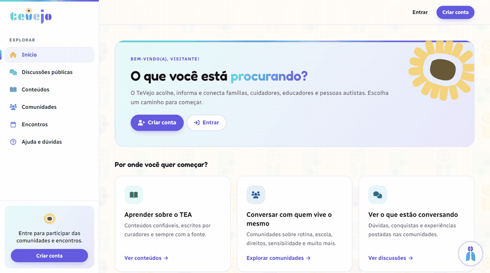
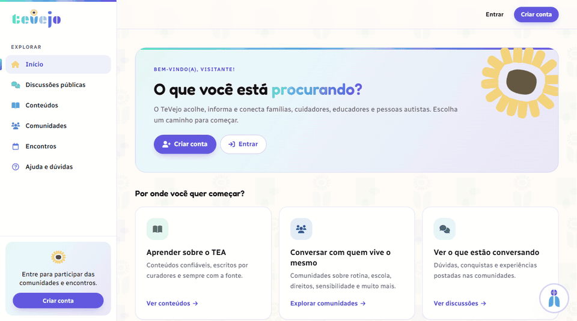
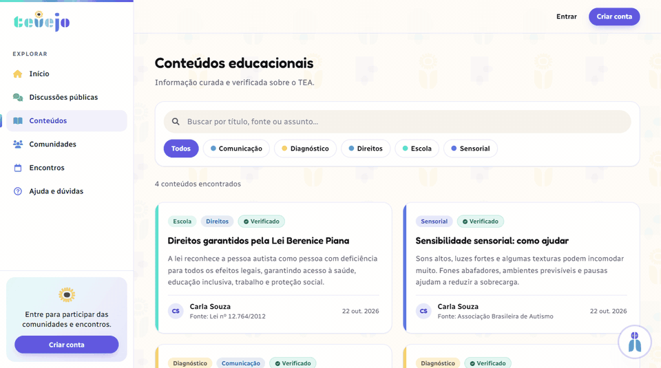
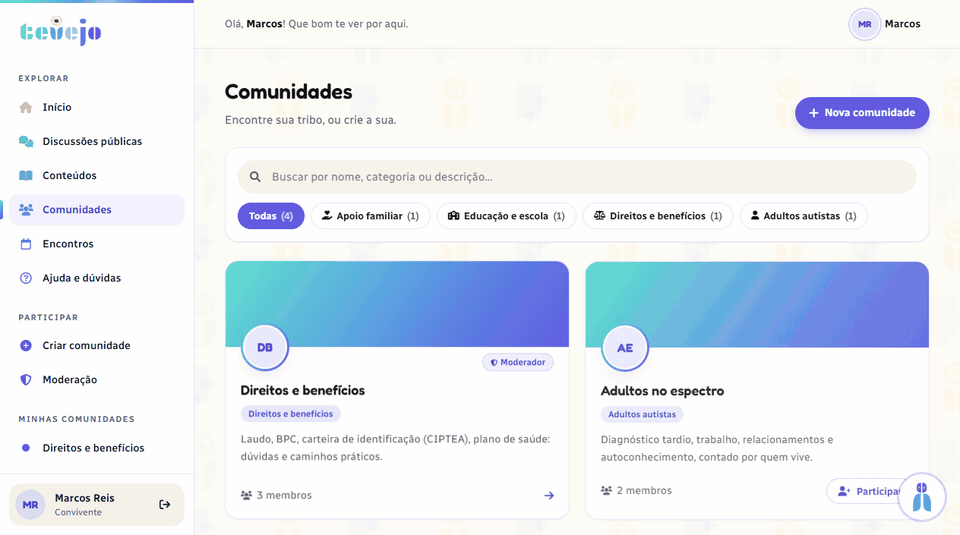
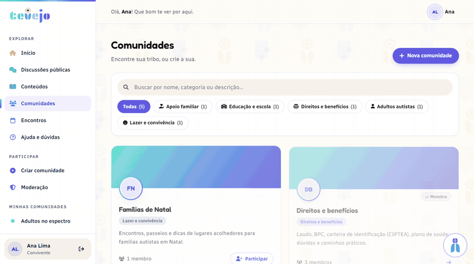
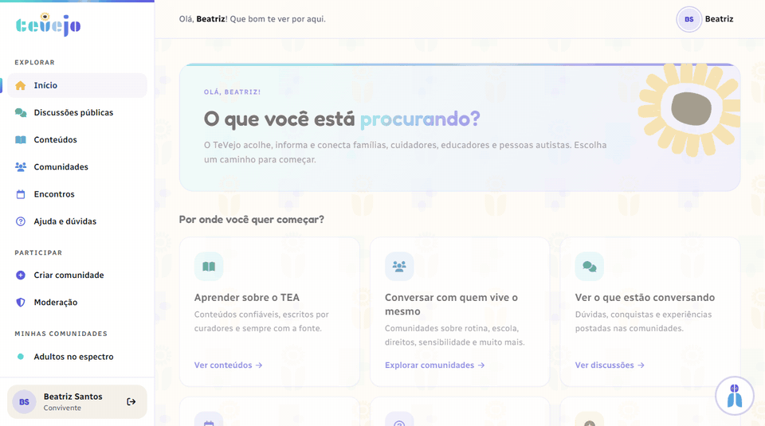
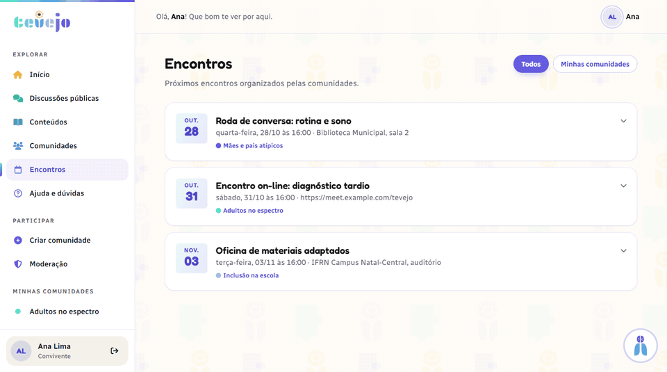
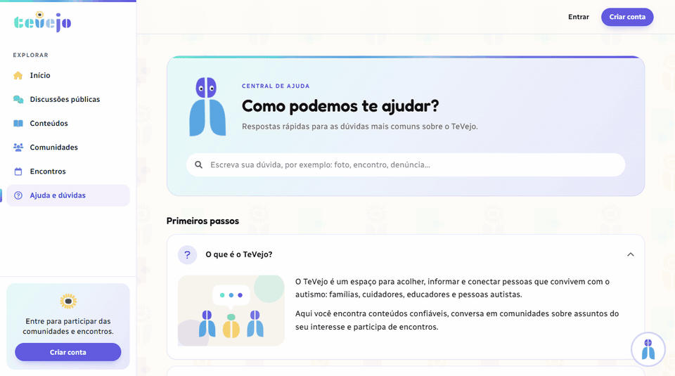

# TeVejo


O Tevejo será uma plataforma web para acolher, informar e conectar pessoas que convivem com autistas
Informatizar: disponibilizar informações confiáveis sobre TEA (Transtorno do Espectro Autista).
Conscientizar: reduzir preconceitos e julgamentos, promovendo empatia.
Apoiar: oferecer um espaço seguro para desabafos, trocas de experiências e suporte emocional.


# Equipe e Formas de Contato

1. Lorrany Fagundes - lorrany.c@escolar.ifrn.edu.br - Discord: loranih  
2. Fernando Yuri - fernando.yuri@escolar.ifrn.edu.br - Discord: yukeera
3. Ramon Couto - couto.s@escolar.ifrn.edu.br - Discord: hajikt
4. Aaron Goldberg - aaron.goldberg@escolar.ifrn.edu.br - Discord: aarongoldberg.
5. João Pedro - magalhaes.joao@escolar.ifrn.edu.br - Discord: joaodantas15
6. Manoel Pinto Junior

# Tecnologias Utilizadas

1. Angular
1. Django Rest
1. Postgres

# Como rodar

## Com Docker (projeto completo)

```bash
cp .env.example .env   # ajuste as senhas
docker compose up --build
```

Acesse http://localhost (API em `/api`, Swagger em `/api/docs`, admin em `/admin`).
Para criar um superusuário: `docker compose exec backend python manage.py createsuperuser`.

## Desenvolvimento local

Backend (SQLite, sem variáveis de ambiente):

```bash
cd src/backend_django
python -m venv .venv && .venv/Scripts/activate   # Linux/Mac: source .venv/bin/activate
pip install -r requirements.txt
python manage.py migrate
python manage.py runserver
```

Frontend (o `ng serve` encaminha `/api` e `/media` para `127.0.0.1:8000`):

```bash
cd src/frontend-angular
npm ci
npm start
```

Acesse http://localhost:4200. Testes: `python manage.py test` e `npm test -- --watch=false`.

> As migrations são versionadas. Ao alterar um model, rode `python manage.py makemigrations` e inclua o arquivo gerado no commit (o CI falha se faltar migration).

# Horário de Reuniões

Segunda-Feira - 22h30 - Discord

Quinta-Feira - 16h30 - IFRN


# Documentação

[Link para os documentos do projeto](doc/documentacao.md)

# Manual do Desenvolvedor

[Orientações para os desenvolvedores do projeto](doc/guia-ds/guia.md)

# Telas do site

### 1. Página inicial - Visitante (CDU028)



### 2. Autocadastro com confirmação de senha (CDU002 e CDU019)



### 3. Login (CDU001)


### 4. Conteúdos educacionais (CDU003)



### 5. Participar de comunidade e interagir (CDU006 e CDU023)



### 6. Postar na comunidade (CDU007)



### 7. Criar comunidade (CDU008)



### 8. Encontros (CDU005)



### 9. Central de ajuda (CDU027)


