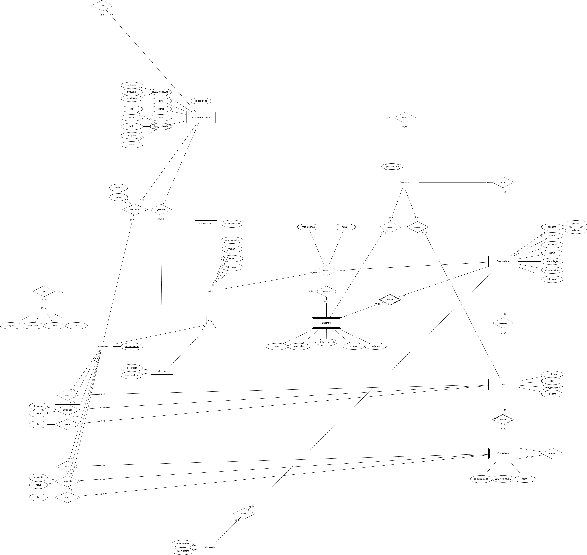
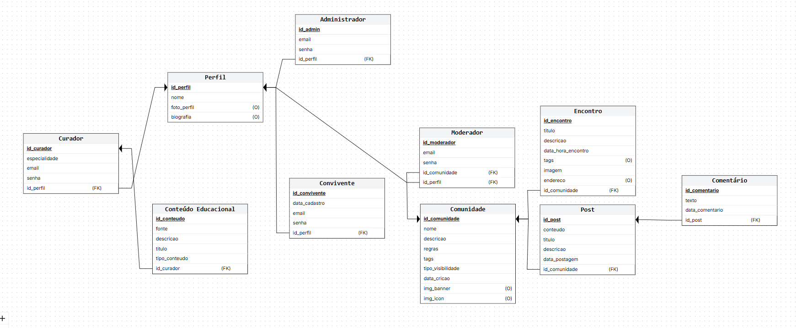

# Modelo de Dados

## Histórico de Revisões

| Data | Versão | Descrição | Autores |
| :--: | :----: | :-------: | :-----: |
| 26/01/2026 | 1.0 | Versão inicial | Aaron, Lorrany, Ramon, Yuri |
| - | - | - |  - |

## 1. Diagrama ER

## 2. Modelo Relacional

## 3. Dicionário de Dados

---

**Tabela** : perfil

*Descrição* : Armazena as informações básicas do perfil do usuário no sistema TeVejo.

*Observações* : Perfil pode ser associado a diferentes tipos de usuários.

| Colunas | Descrição | Tipo de Dado | Tamanho | Null | PK | FK | Unique | Identity | Default | Check |
| ------- | --------- | ------------ | ------- | ---- | -- | -- | ------ | -------- | ------- | ----- |
| id_perfil | Identificador único do perfil | INT | — | &#9744; | &#9745; | &#9744; | &#9744; | &#9745; | — | — |
| nome | Nome do perfil | VARCHAR | 100 | &#9744; | &#9744; | &#9744; | &#9744; | &#9744; | — | — |
| foto_perfil | Caminho da foto do perfil | VARCHAR | 255 | &#9745; | &#9744; | &#9744; | &#9744; | &#9744; | — | — |
| biografia | Texto biográfico do perfil | TEXT | — | &#9745; | &#9744; | &#9744; | &#9744; | &#9744; | — | — |

---

**Tabela** : comunidade

*Descrição* : Armazena as comunidades existentes na plataforma.

*Observações* : Comunidades agrupam usuários, posts e encontros.

| Colunas | Descrição | Tipo de Dado | Tamanho | Null | PK | FK | Unique | Identity | Default | Check |
| ------- | --------- | ------------ | ------- | ---- | -- | -- | ------ | -------- | ------- | ----- |
| id_comunidade | Identificador único da comunidade | INT | — | &#9744; | &#9745; | &#9744; | &#9744; | &#9745; | — | — |
| nome | Nome da comunidade | VARCHAR | 100 | &#9744; | &#9744; | &#9744; | &#9744; | &#9744; | — | — |
| foto_comunidade | Caminho da foto da comunidade | VARCHAR | 255 | &#9745; | &#9744; | &#9744; | &#9744; | &#9744; | — | — |
| biografia | Descrição da comunidade | TEXT | — | &#9745; | &#9744; | &#9744; | &#9744; | &#9744; | — | — |

---

**Tabela** : administrador

*Descrição* : Armazena os dados do usuário do tipo Administrador.

*Observações* : Administradores possuem privilégios gerais no sistema.

| Colunas | Descrição | Tipo de Dado | Tamanho | Null | PK | FK | Unique | Identity | Default | Check |
| ------- | --------- | ------------ | ------- | ---- | -- | -- | ------ | -------- | ------- | ----- |
| id_admin | Identificador único do administrador | INT | — | &#9744; | &#9745; | &#9744; | &#9744; | &#9745; | — | — |
| email | E-mail do administrador | VARCHAR | 100 | &#9744; | &#9744; | &#9744; | &#9745; | &#9744; | — | — |
| senha | Senha do administrador | VARCHAR | 100 | &#9744; | &#9744; | &#9744; | &#9744; | &#9744; | — | — |
| id_perfil | Perfil associado ao administrador | INT | — | &#9744; | &#9744; | &#9745; | &#9744; | &#9744; | — | — |

---

**Tabela** : moderador

*Descrição* : Armazena os dados do usuário do tipo Moderador da plataforma.

*Observações* : O moderador é responsável pela moderação de uma comunidade específica.

| Colunas | Descrição | Tipo de Dado | Tamanho | Null | PK | FK | Unique | Identity | Default | Check |
| ------- | --------- | ------------ | ------- | ---- | -- | -- | ------ | -------- | ------- | ----- |
| id_moderador | Identificador único do moderador | INT | — | &#9744; | &#9745; | &#9744; | &#9744; | &#9745; | — | — |
| email | E-mail do moderador | VARCHAR | 100 | &#9744; | &#9744; | &#9744; | &#9745; | &#9744; | — | — |
| senha | Senha do moderador | VARCHAR | 100 | &#9744; | &#9744; | &#9744; | &#9744; | &#9744; | — | — |
| id_comunidade | Comunidade sob responsabilidade do moderador | INT | — | &#9744; | &#9744; | &#9745; | &#9744; | &#9744; | — | — |
| id_perfil | Perfil associado ao moderador | INT | — | &#9744; | &#9744; | &#9745; | &#9744; | &#9744; | — | — |

---

**Tabela** : curador

*Descrição* : Armazena os dados do usuário do tipo Curador.

*Observações* : Curadores produzem conteúdos educacionais.

| Colunas | Descrição | Tipo de Dado | Tamanho | Null | PK | FK | Unique | Identity | Default | Check |
| ------- | --------- | ------------ | ------- | ---- | -- | -- | ------ | -------- | ------- | ----- |
| id_curador | Identificador único do curador | INT | — | &#9744; | &#9745; | &#9744; | &#9744; | &#9745; | — | — |
| especialidade | Área de especialidade do curador | VARCHAR | 100 | &#9744; | &#9744; | &#9744; | &#9744; | &#9744; | — | — |
| email | E-mail do curador | VARCHAR | 100 | &#9744; | &#9744; | &#9744; | &#9745; | &#9744; | — | — |
| senha | Senha do curador | VARCHAR | 100 | &#9744; | &#9744; | &#9744; | &#9744; | &#9744; | — | — |
| id_perfil | Perfil associado ao curador | INT | — | &#9744; | &#9744; | &#9745; | &#9744; | &#9744; | — | — |

---

**Tabela** : convivente

*Descrição* : Armazena os dados do usuário do tipo Convivente.

*Observações* : Usuário padrão da plataforma.

| Colunas | Descrição | Tipo de Dado | Tamanho | Null | PK | FK | Unique | Identity | Default | Check |
| ------- | --------- | ------------ | ------- | ---- | -- | -- | ------ | -------- | ------- | ----- |
| id_convivente | Identificador único do convivente | INT | — | &#9744; | &#9745; | &#9744; | &#9744; | &#9745; | — | — |
| email | E-mail do convivente | VARCHAR | 100 | &#9744; | &#9744; | &#9744; | &#9745; | &#9744; | — | — |
| senha | Senha do convivente | VARCHAR | 100 | &#9744; | &#9744; | &#9744; | &#9744; | &#9744; | — | — |
| id_perfil | Perfil associado ao convivente | INT | — | &#9744; | &#9744; | &#9745; | &#9744; | &#9744; | — | — |

---

**Tabela** : post

*Descrição* : Armazena as publicações feitas nas comunidades.

*Observações* : Cada post pertence a uma comunidade.

| Colunas | Descrição | Tipo de Dado | Tamanho | Null | PK | FK | Unique | Identity | Default | Check |
| ------- | --------- | ------------ | ------- | ---- | -- | -- | ------ | -------- | ------- | ----- |
| id_post | Identificador único do post | INT | — | &#9744; | &#9745; | &#9744; | &#9744; | &#9745; | — | — |
| titulo | Título do post | VARCHAR | 150 | &#9744; | &#9744; | &#9744; | &#9744; | &#9744; | — | — |
| conteudo | Conteúdo textual do post | TEXT | — | &#9744; | &#9744; | &#9744; | &#9744; | &#9744; | — | — |
| data_postagem | Data da postagem | DATE | — | &#9744; | &#9744; | &#9744; | &#9744; | &#9744; | — | — |
| id_comunidade | Comunidade associada | INT | — | &#9744; | &#9744; | &#9745; | &#9744; | &#9744; | — | — |

--- 

**Tabela** : comentario

*Descrição* : Armazena os comentários realizados em posts das comunidades.

*Observações* : Todo comentário está obrigatoriamente associado a um post.

| Colunas | Descrição | Tipo de Dado | Tamanho | Null | PK | FK | Unique | Identity | Default | Check |
| ------- | --------- | ------------ | ------- | ---- | -- | -- | ------ | -------- | ------- | ----- |
| id_comentario | Identificador único do comentário | INT | — | &#9744; | &#9745; | &#9744; | &#9744; | &#9745; | — | — |
| texto | Texto do comentário | TEXT | — | &#9744; | &#9744; | &#9744; | &#9744; | &#9744; | — | — |
| data_comentario | Data em que o comentário foi realizado | DATE | — | &#9744; | &#9744; | &#9744; | &#9744; | &#9744; | — | — |
| id_post | Identificador do post comentado | INT | — | &#9744; | &#9744; | &#9745; | &#9744; | &#9744; | — | — |

---

**Tabela** : encontro

*Descrição* : Armazena os encontros organizados pelas comunidades.

*Observações* : Encontros podem ser presenciais ou virtuais e pertencem a uma comunidade.

| Colunas | Descrição | Tipo de Dado | Tamanho | Null | PK | FK | Unique | Identity | Default | Check |
| ------- | --------- | ------------ | ------- | ---- | -- | -- | ------ | -------- | ------- | ----- |
| id_encontro | Identificador único do encontro | INT | — | &#9744; | &#9745; | &#9744; | &#9744; | &#9745; | — | — |
| titulo | Título do encontro | VARCHAR | 150 | &#9744; | &#9744; | &#9744; | &#9744; | &#9744; | — | — |
| descricao | Descrição detalhada do encontro | TEXT | — | &#9744; | &#9744; | &#9744; | &#9744; | &#9744; | — | — |
| data_encontro | Data de realização do encontro | DATE | — | &#9744; | &#9744; | &#9744; | &#9744; | &#9744; | — | — |
| endereco | Endereço do encontro | VARCHAR | 150 | &#9744; | &#9744; | &#9744; | &#9744; | &#9744; | — | — |
| id_comunidade | Comunidade organizadora do encontro | INT | — | &#9744; | &#9744; | &#9745; | &#9744; | &#9744; | — | — |

---

**Tabela** : conteudo_educacional

*Descrição* : Armazena os conteúdos educacionais disponibilizados na plataforma.

*Observações* : Todo conteúdo educacional é produzido por um curador.

| Colunas | Descrição | Tipo de Dado | Tamanho | Null | PK | FK | Unique | Identity | Default | Check |
| ------- | --------- | ------------ | ------- | ---- | -- | -- | ------ | -------- | ------- | ----- |
| id_conteudo | Identificador único do conteúdo | INT | — | &#9744; | &#9745; | &#9744; | &#9744; | &#9745; | — | — |
| titulo | Título do conteúdo educacional | VARCHAR | 150 | &#9744; | &#9744; | &#9744; | &#9744; | &#9744; | — | — |
| fonte | Fonte ou referência do conteúdo | VARCHAR | 255 | &#9745; | &#9744; | &#9744; | &#9744; | &#9744; | — | — |
| descricao | Descrição do conteúdo educacional | TEXT | — | &#9745; | &#9744; | &#9744; | &#9744; | &#9744; | — | — |
| id_curador | Curador responsável pelo conteúdo | INT | — | &#9744; | &#9744; | &#9745; | &#9744; | &#9744; | — | — |

---

**Tabela** : notificacao

*Descrição* : Armazena as notificações enviadas aos usuários da plataforma.

*Observações* : A notificação pode estar relacionada a um post, comentário ou encontro.

| Colunas | Descrição | Tipo de Dado | Tamanho | Null | PK | FK | Unique | Identity | Default | Check |
| ------- | --------- | ------------ | ------- | ---- | -- | -- | ------ | -------- | ------- | ----- |
| id_notificacao | Identificador único da notificação | INT | — | &#9744; | &#9745; | &#9744; | &#9744; | &#9745; | — | — |
| data_envio | Data de envio da notificação | DATE | — | &#9744; | &#9744; | &#9744; | &#9744; | &#9744; | — | — |
| mensagem | Mensagem enviada na notificação | VARCHAR | 255 | &#9744; | &#9744; | &#9744; | &#9744; | &#9744; | — | — |
| id_encontro | Encontro relacionado à notificação | INT | — | &#9745; | &#9744; | &#9745; | &#9744; | &#9744; | — | — |
| id_comentario | Comentário relacionado à notificação | INT | — | &#9745; | &#9744; | &#9745; | &#9744; | &#9744; | — | — |
| id_post | Post relacionado à notificação | INT | — | &#9745; | &#9744; | &#9745; | &#9744; | &#9744; | — | — |

