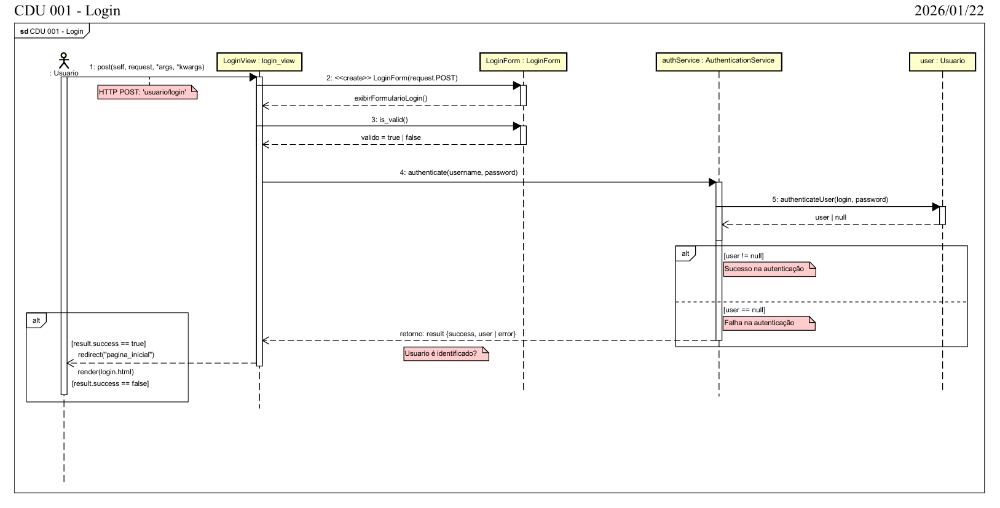
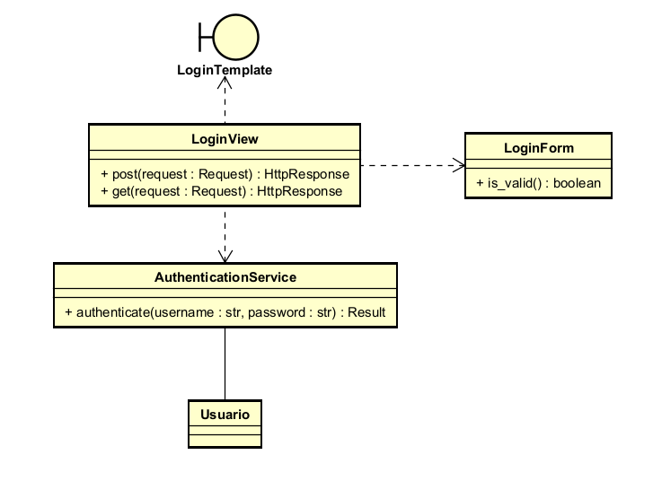

# CDU001. Fazer Login

- **Atores principais**: Convivente, Curador, Moderador ou Administrador.
- **Atores secundários**: Nenhum.	 
- **Resumo**: Qualquer usuário cadastrado/autenticado no Tevejo pode Fazer Login, permitindo acesso às funcionalidades restritas conforme o seu tipo de perfil de usuário.
- **Pré-condição**: O usuário deve possuir um cadastro ativo no sistema.
- **Pós-Condição**: Após logado, o usuário é redirecionado à página inicial. O sistema mantém a sessão autenticada até logout.

## Fluxo Principal - Credenciais Válidas
| Ações do ator | Ações do sistema |
| :-----------------: | :-----------------: | 
| 1 - O usuário acessa a página de login. | |  
| | 2 - O sistema exibe o formulário de login, solicitando e-mail e senha. | 
| 3 - O usuário informa e-mail e senha e clica em “Fazer Login”. | |
||4 - O sistema valida as credenciais informadas.|
||5 - O sistema redireciona o usuário para a tela inicial.||

## Fluxo Alternativo I - Credenciais inválidas
| Ações do ator | Ações do sistema |
| :-----------------: |:-----------------: | 
|| 4.1 - O sistema não valida as credenciais informadas. O usuário informou e-mail e/ou senha incorretos.| |
|| 4.2 - O sistema exibe uma mensagem de erro (“Usuário ou senha inválidos”) e solicita nova tentativa. ||

> Obs. as seções a seguir apenas serão utilizadas na segunda unidade do PDSWeb (segundo orientações do gerente do projeto).

## Diagrama de Interação (Sequência ou Comunicação)

>

## Diagrama de Classes de Projeto

>
