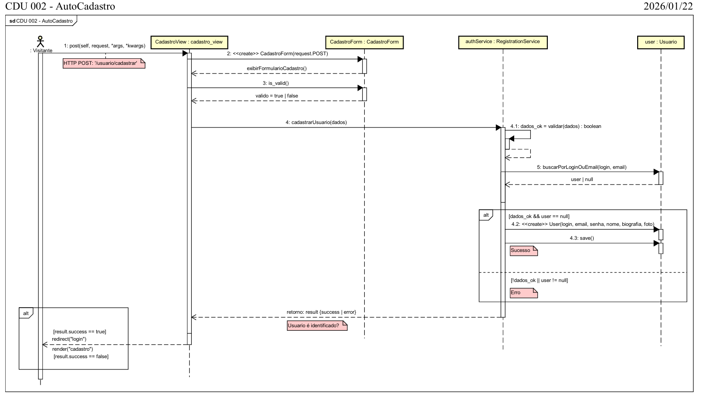
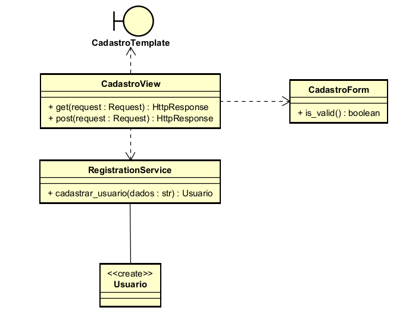

# CDU002. Auto Cadastro

- **Ator principal**: Convivente
- **Atores secundários**: Nenhum
- **Resumo**: Um visitante do Tevejo consegue de forma autônoma preencher as informações no formulário de cadastro.
- **Pré-condição**: Não estar autenticado no Tevejo
- **Pós-Condição**: Após realizar o Auto cadastro o antes visitante e agora convivente passa a estar autenticado na plataforma.

## Fluxo Principal
| Ações do ator | Ações do sistema |
| :-----------------: | :-----------------: | 
| 1 - O Visitante Clica em Cadastrar-se | |  
| | 2 - O Sistema exibe o formulário de cadastro |
| 3 - O Visitante preenche o formulário com nome, usuário, e-mail, senha e a confirmação da senha | |  
| | 4 - O Sistema valida as informações de cadastro |
| | 5 - O Sistema realiza a autenticação na plataforma após o cadastro | 

## Fluxo Alternativo I - ...
| Ações do ator | Ações do sistema |
| :-----------------: |:-----------------: | 
|  | |  
| | 4.1 - o sistema torna a exibir o fomulário, destacando as informações que faltaram (obrigatórias) ou estavam inválidas, e pede que o visitante as corrija. |
| (retorna ao passo 2 do fluxo principal) | |  
| | |

## Fluxo Alternativo II - Senhas diferentes
| Ações do ator | Ações do sistema |
| :-----------------: |:-----------------: | 
| 3.1 - O Visitante digita na confirmação uma senha diferente da senha informada | |  
| | 3.2 - O sistema destaca o campo de confirmação com a mensagem "As senhas não coincidem." e não cria a conta. |
| (retorna ao passo 3 do fluxo principal) | |  

> Obs. as seções a seguir apenas serão utilizadas na segunda unidade do PDSWeb (segundo orientações do gerente do projeto).

## Diagrama de Interação (Sequência ou Comunicação)

>

## Diagrama de Classes de Projeto

>