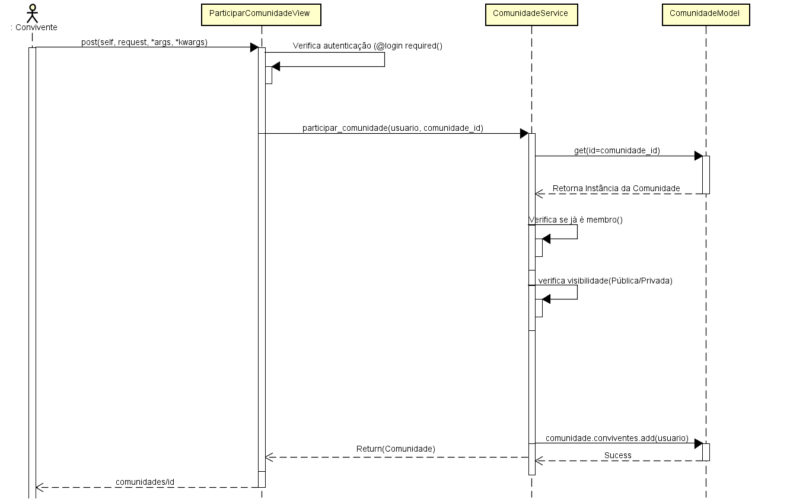
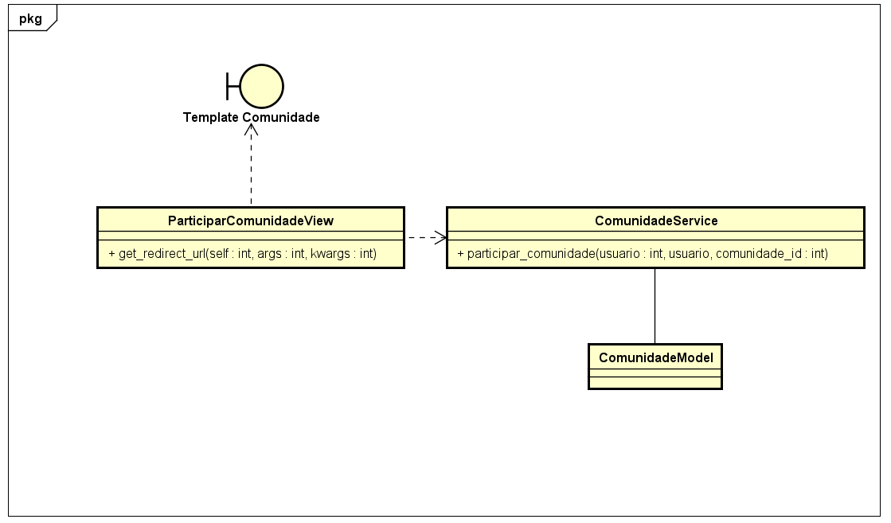

# CDU006. Participar de Comunidade

- **Ator principal**: Convivente
- **Atores secundários**: Moderador
- **Resumo**: O Convivente, após navegar na aba de comunidades, clica no botão "Participar" de determinada comunidade para se tornar membro da mesma.
- **Pré-condição**: O convivente não deve ser membro ativo da comunidade na qual deseja ingressar.
- **Pós-Condição**: O convivente torna-se membro da comunidade imediatamente.

## Fluxo Principal - Unindo-se a Comunidade
| Ações do ator | Ações do sistema |
| :-----------------: | :-----------------: |
| 1 - O Convivente clica no botão "Unir-se" ou "Participar" de uma determinada comunidade. | |
| | 2 - O sistema verifica se o usuário está autenticado. |
| | 3 - O sistema verifica se a comunidade é pública ou privada. |
| | 4 - O sistema torna o convivente membro do espaço. |
| | 5 - O sistema atualiza a interface, altera o botão para "Membro" e exibe mensagem de sucesso. |

---

## Fluxos de Exceção

### FE01 - Usuário Não Autenticado
| Ações do ator | Ações do sistema |
| :-----------------: | :-----------------: |
| | 1.1 - No passo 2 do Fluxo Principal, o sistema identifica que o usuário não está autenticado. |
| | 1.2 - O sistema redireciona o visitante para a tela de autenticação (Login) e encerra este caso de uso. |

---

> Obs. as seções a seguir apenas serão utilizadas na segunda unidade do PDSWeb (segundo orientações do gerente do projeto).

## Diagrama de Interação (Sequência ou Comunicação)

>

## Diagrama de Classes de Projeto

>
