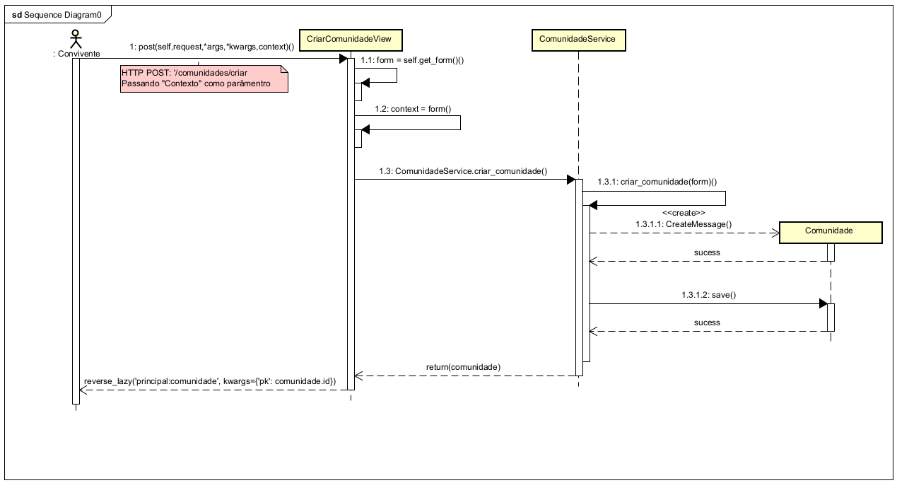
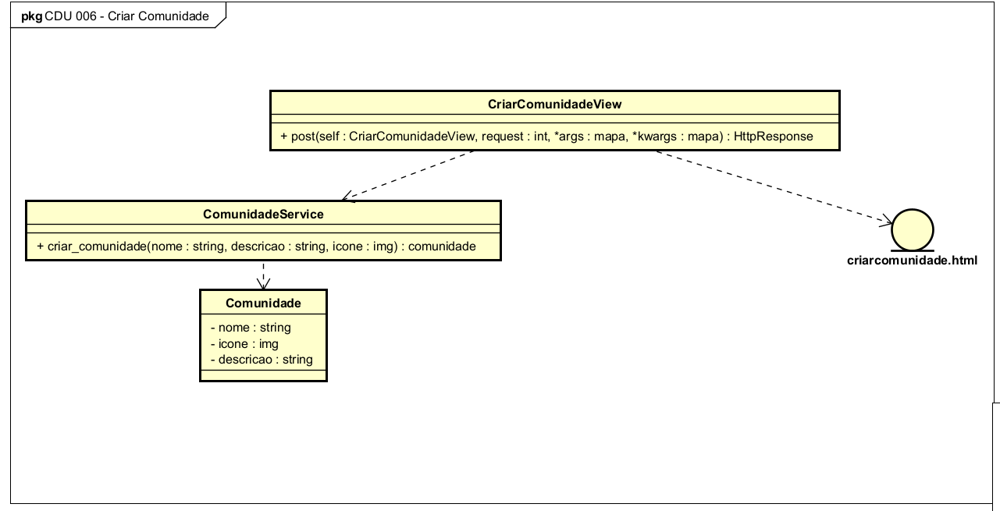
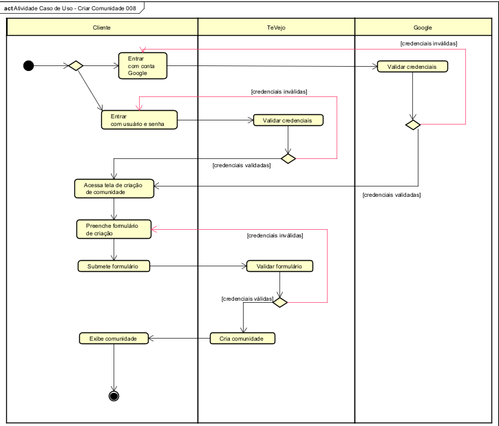

# CDU008. Criar comunidade

- **Ator principal**: Convivente
- **Atores secundários**: Não existe.
- **Resumo**: Esse caso de uso descreve como um convivente cria uma nova comunidade na plataforma, definindo nome, descrição, regras e categoria/tema. O objetivo é permitir a organização de espaços de apoio e troca de experiências por interesse comum.
- **Pré-condição**: O convivente deve estar autenticado e com conta ativa na plataforma.
- **Pós-Condição**: A comunidade é criada com sucesso, o convivente passa a ser seu moderador inicial e a comunidade fica disponível para visualização.

## Fluxo Principal - Criar comunidade com sucesso
| Ações do ator | Ações do sistema |
| :-----------------: | :-----------------: |
| 1 - O convivente acessa a opção “Criar Comunidade”. | |
| | 2 - O sistema exibe o formulário de criação com campos obrigatórios (nome, descrição e categoria/tema). |
| 3 - O convivente preenche os dados da comunidade e confirma a criação. | |
| | 4 - O sistema valida os dados informados (formato e regras mínimas). |
| | 5 - O sistema registra a comunidade, associa o convivente como moderador inicial e exibe mensagem de sucesso. |
| | 6 - O sistema redireciona para a página da nova comunidade. |

## Fluxos de Exceção

### FE01 - Nome de comunidade já existente
| Ações do ator | Ações do sistema |
| :-----------------: | :-----------------: |
| 1.1 - No passo 3 do Fluxo Principal, o convivente informa um nome já utilizado por outra comunidade. | |
| | 1.2 - O sistema bloqueia a criação, exibe a mensagem: “Já existe uma comunidade com esse nome.” e retorna ao passo 2 do Fluxo Principal. |

### FE02 - Campos obrigatórios inválidos ou ausentes
| Ações do ator | Ações do sistema |
| :-----------------: | :-----------------: |
| 2.1 - No passo 3 do Fluxo Principal, o convivente envia o formulário incompleto ou com campos inválidos. | |
| | 2.2 - O sistema destaca os campos com problema, exibe mensagem de validação para correção e retorna ao passo 2 do Fluxo Principal. |

### FE03 - Falha técnica no cadastro
| Ações do ator | Ações do sistema |
| :-----------------: | :-----------------: |
| 3.1 - No passo 3 do Fluxo Principal, o convivente confirma a criação da comunidade. | |
| | 3.2 - O sistema identifica uma falha técnica (conexão, serviço ou banco de dados), exibe a mensagem: “Não foi possível criar a comunidade no momento. Tente novamente.” e encerra o caso de uso sem salvar as alterações. |

## Diagrama de Interação (Sequência ou Comunicação)

>

## Diagrama de Classes de Projeto

>

## Diagrama de Atividade

>
