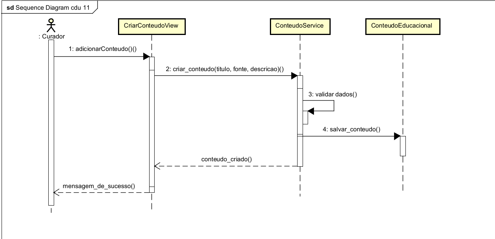
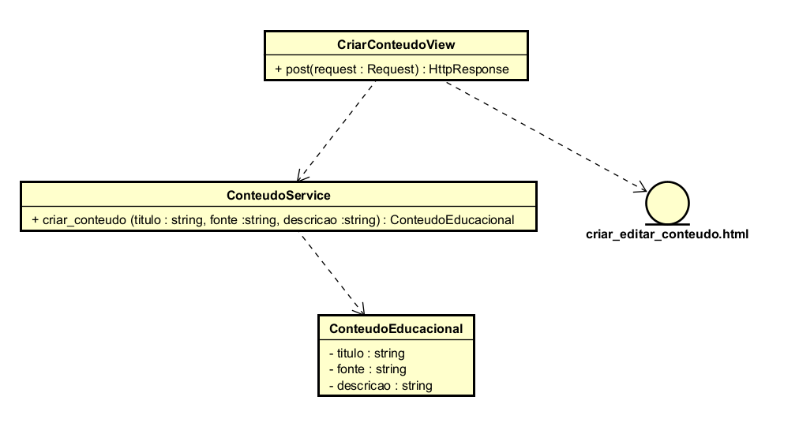

# CDU011. Gerenciar Conteúdo Educacional

- **Ator principal**: Curador
- **Atores secundários**: Não existe.
- **Resumo**: Esse caso de uso descreve como o curador cadastra, edita e remove conteúdos educacionais da plataforma TeVejo. O objetivo é manter uma base de conteúdos atualizada, segura e relevante para os conviventes.
- **Pré-condição**: O usuário deve estar autenticado com perfil de curador e possuir permissão ativa para gerenciamento de conteúdos.
- **Pós-Condição**: O conteúdo educacional é criado, atualizado ou removido com registro da ação no sistema.

## Fluxo Principal - Adicionar conteúdo educacional
| Ações do ator | Ações do sistema |
| :-----------------: | :-----------------: |
| 1 - O curador acessa a opção “Adicionar Conteúdo”. | |
| | 2 - O sistema exibe formulário com os campos obrigatórios (título, fonte, tags e corpo do conteúdo) e opcionais (imagem/anexo). |
| 3 - O curador preenche os dados e confirma em “Publicar Conteúdo”. | |
| | 4 - O sistema valida as informações enviadas. |
| | 5 - O sistema salva o conteúdo, registra autoria/data e retorna para a listagem com mensagem de sucesso. |

## Fluxo Alternativo I - Editar conteúdo existente
| Ações do ator | Ações do sistema |
| :-----------------: | :-----------------: |
| 1.1 - O curador seleciona um conteúdo já publicado na listagem. | |
| | 1.2 - O sistema exibe formulário de edição com os dados atuais. |
| 1.3 - O curador altera as informações desejadas e confirma a atualização. | |
| | 1.4 - O sistema valida os dados e salva as alterações, mantendo histórico da modificação. |
| | 1.5 - O sistema exibe confirmação: “Conteúdo atualizado com sucesso.” |

## Fluxo Alternativo II - Remover conteúdo
| Ações do ator | Ações do sistema |
| :-----------------: | :-----------------: |
| 2.1 - O curador seleciona a opção de remover um conteúdo. | |
| | 2.2 - O sistema solicita confirmação da remoção e apresenta impacto da ação. |
| 2.3 - O curador confirma a remoção. | |
| | 2.4 - O sistema exclui o conteúdo e exibe mensagem de sucesso. | 

## Fluxo de Exceção I - Dados inválidos no formulário
| Ações do ator | Ações do sistema |
| :-----------------: | :-----------------: |
| 3.1 - O curador envia o formulário com campos obrigatórios ausentes ou inválidos. | |
| | 3.2 - O sistema não persiste os dados, destaca os campos com erro e exibe orientações para correção. |
| 3.3 - O curador corrige as informações e envia novamente. | |

## Fluxo de Exceção II - Falha técnica ao persistir conteúdo
| :-----------------: | :-----------------: |
| 4.1 - O curador confirma uma operação de criar, editar ou remover conteúdo. | |
| | 4.2 - O sistema detecta falha técnica (serviço, conexão ou banco de dados) e exibe a mensagem: “Não foi possível concluir a operação no momento.” |

> Obs. as seções a seguir apenas serão utilizadas na segunda unidade do PDSWeb (segundo orientações do gerente do projeto).

## Diagrama de Interação (Sequência ou Comunicação)

>

## Diagrama de Classes de Projeto

>