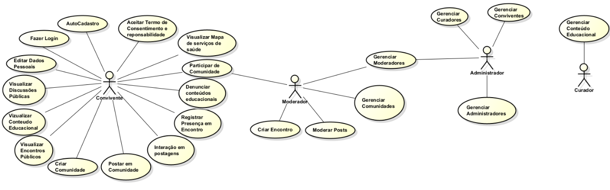

# Modelo de Casos de Uso

## Histórico de Revisões

| Data | Versão | Descrição | Autores |
| :--: | :----: | :-------: | :-----: |
| 23/10/2025 | 1.0 | Versão inicial |  Lorrany Fagundes |
| 05/02/2026 | 1.1 | Versão Atualizada |  Fernando Yuri |
| 19/10/2026 | 1.2 | Inclusão do CDU-026 (Guia Condutor) e do CDU-027 (Consultar Ajuda e FAQ) |  Aaron Goldberg |
| 22/10/2026 | 1.3 | Inclusão do CDU-028 (Visualizar Página Inicial) e confirmação de senha no CDU-002 |  Ramon Couto |
| - | - | - |  - |

## 1. Diagrama de Casos de Uso

## 2. Listagem dos Detalhamentos dos Casos de Uso

1. [CDU-002 - Autocadastro](cdu-002/detalhamento-002.md) ✅
2. [CDU-019 - Exibir Termo de Consentimento e reponsabilidade](cdu-019/detalhamento-019.md)
1. [CDU-001 - Fazer Login](cdu-001/detalhamento-001.md) ✅
2. [CDU-008 - Criar Comunidade](cdu-008/detalhamento-008.md) ✅
2. [CDU-006 - Participar de Comunidade](cdu-006/detalhamento-006.md) ✅
2. [CDU-007 - Postar em Comunidade](cdu-007/detalhamento-007.md) ✅

2. [CDU-004 - Visualizar Discussões Públicas](cdu-004/detalhamento-004.md) ✅

2. [CDU-016 - Gerenciar Curadores](cdu-016/detalhamento-016.md) ✅
2. [CDU-011 - Gerenciar Conteúdo Educacional](cdu-011/detalhamento-011.md) ✅
2. [CDU-003 - Visualizar Conteúdo Educacional](cdu-003/detalhamento-003.md) ✅

2. [CDU-024 - Moderar Conviventes](cdu-024/detalhamento-024.md) ✅
2. [CDU-025 - Analisar Denuncias](cdu-025/detalhamento-025.md) ✅

2. [CDU-010 - Criar Encontro](cdu-010/detalhamento-010.md)
2. [CDU-005 - Visualizar Encontros Públicos](cdu-005/detalhamento-005.md)
2. [CDU-009 - Registrar Presença em Encontro](cdu-009/detalhamento-009.md)

2. [CDU-022 - Denunciar conteúdos educacionais](cdu-022/detalhamento-022.md)
2. [CDU-023 - Interação em postagens](cdu-023/detalhamento-023.md)
2. [CDU-012 - Gerenciar Comunidades](cdu-012/detalhamento-012.md)

2. [CDU-018 - Editar Dados Pessoais](cdu-018/detalhamento-018.md) ✅

2. [CDU-009 - Visualizar Mapa de serviços de saúde](cdu-009/detalhamento-009.md)

2. [CDU-015 - Gerenciar Moderadores](cdu-015/detalhamento-015.md)
2. [CDU-017 - Gerenciar Conviventes](cdu-017/detalhamento-017.md) ✅
2. [CDU-014 - Gerenciar Administradores](cdu-014/detalhamento-014.md)

2. [CDU-026 - Guia Condutor](cdu-026/detalhamento-026.md) ✅
2. [CDU-027 - Consultar Ajuda e Perguntas Frequentes](cdu-027/detalhamento-027.md) ✅
2. [CDU-028 - Visualizar Página Inicial](cdu-028/detalhamento-028.md) ✅
