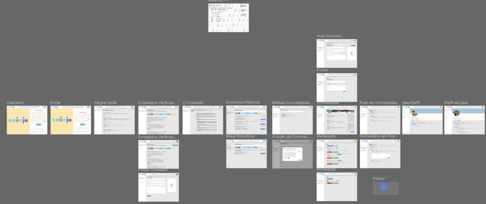

# Protótipos de Interface com o Usuário

## Histórico de Revisões

| Data | Versão | Descrição | Autores |
| :--: | :----: | :-------: | :-----: |
| 23/10/2025 | 1.0| Versão inicial | Fernando Yuri |
| - | - | - |  - |

## 1. Mapa do Site

 

> Obs.: propõem-se a utilização de alguma ferramenta que possibilite a representação textual do diagrama. como o seguinte exemplo:

https://www.figma.com/design/aWb0CbcETqPAI0VXqM8EBE/tevejo?node-id=0-1&p=f&t=sqqNWimhXzI4p4gy-0

### 2. Wireframes FIGMA:

> Obs. Substituir pela captura das imagens, sejam elas provenientes do Figma (anexar também o link para o Figma) ou já em HTML e CSS...

https://www.figma.com/design/aWb0CbcETqPAI0VXqM8EBE/tevejo?node-id=2-31&p=f&t=sqqNWimhXzI4p4gy-0
