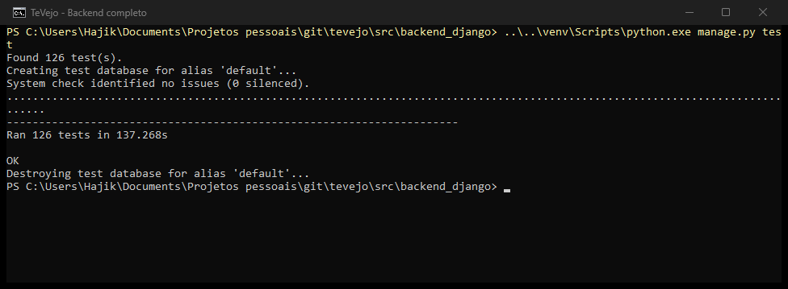
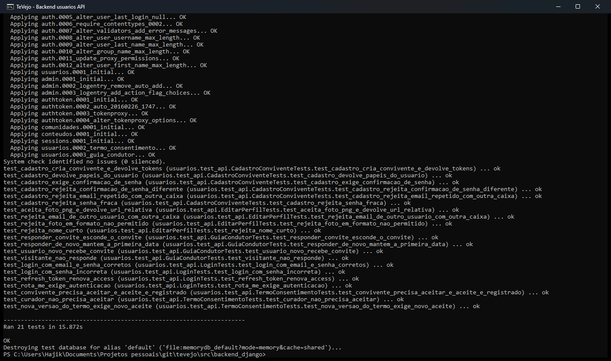
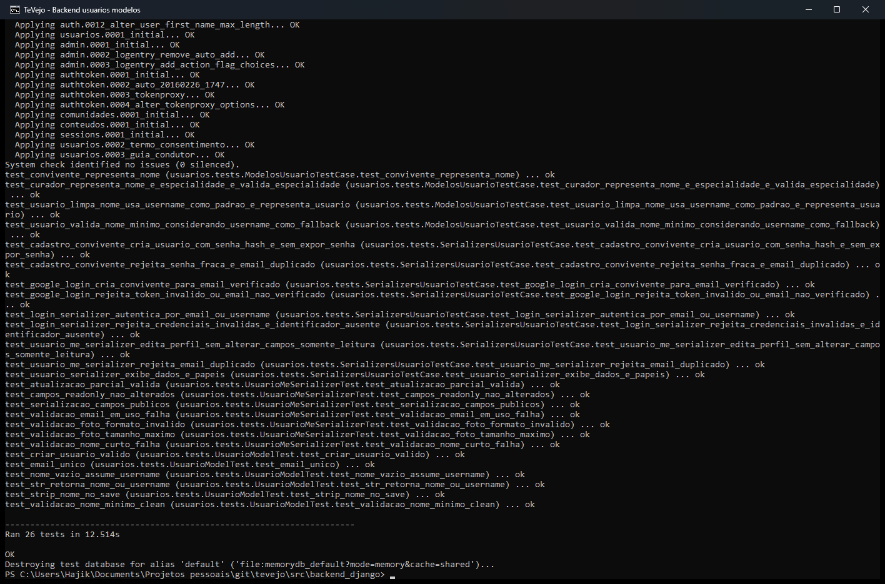
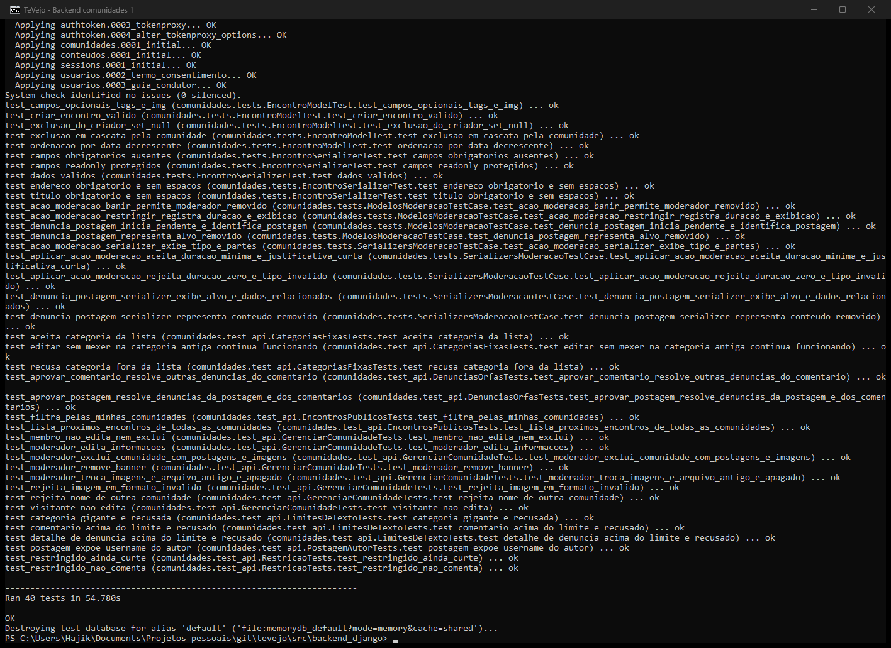
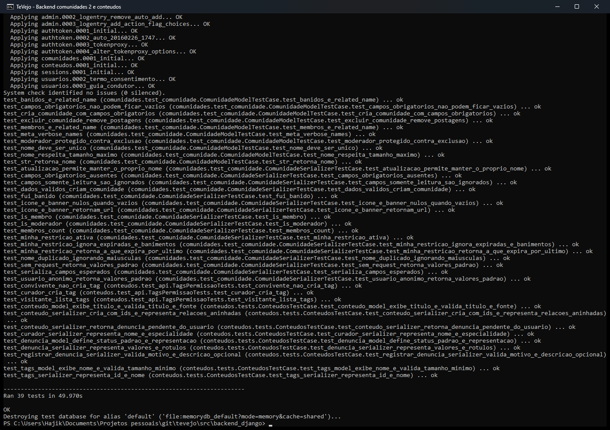
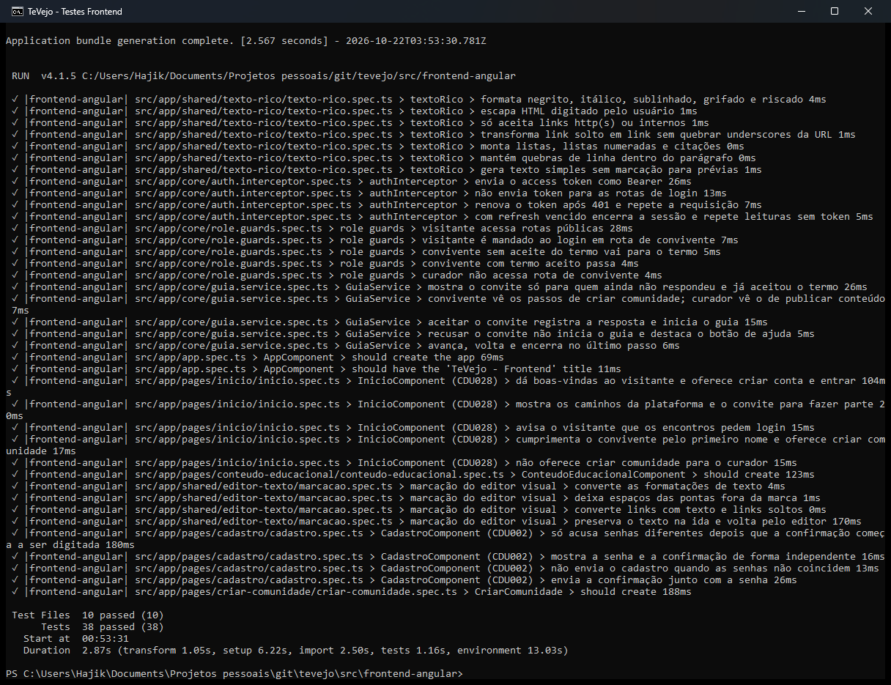

# Testes do TeVejo

Esta pasta organiza os testes do projeto: os casos de teste (planejamento), o código dos testes unitários e as evidências de execução.

## 1. Casos de teste (planejamento)

- [Casos de teste dos CDUs](../casos-de-teste-tevejo.md) — classes de equivalência e análise de valor limite por CDU.

## 2. Código dos testes unitários

### Backend (Django REST — `python manage.py test`)

| Arquivo | Testes | O que cobre |
| :--- | :---: | :--- |
| [usuarios/tests.py](../../src/backend_django/usuarios/tests.py) | 26 | Modelos e serializers de usuário, login e cadastro (CDU001, CDU002) e editar dados pessoais (CDU018) |
| [usuarios/test_api.py](../../src/backend_django/usuarios/test_api.py) | 21 | API de cadastro com confirmação de senha (CDU002), login (CDU001), editar perfil (CDU018), termo de consentimento (CDU019), guia condutor (CDU026) |
| [comunidades/test_comunidade.py](../../src/backend_django/comunidades/test_comunidade.py) | 27 | Modelo e serializer de comunidade (CDU008, CDU006) |
| [comunidades/tests.py](../../src/backend_django/comunidades/tests.py) | 19 | Modelos e serializers de moderação e denúncias (CDU024, CDU025) e de encontros (CDU010) |
| [comunidades/test_api.py](../../src/backend_django/comunidades/test_api.py) | 21 | Restrição (CDU024), denúncias (CDU025), encontros (CDU005), gerenciar comunidade (CDU012), postagens e comentários (CDU007, CDU023) |
| [conteudos/tests.py](../../src/backend_django/conteudos/tests.py) | 9 | Modelos e serializers de conteúdo, tags e denúncias (CDU003, CDU011) |
| [conteudos/test_api.py](../../src/backend_django/conteudos/test_api.py) | 3 | Permissão de criação de tags (CDU011) |
| **Total** | **126** | |

### Frontend (Angular + Vitest — `npm test -- --watch=false`)

| Arquivo | O que cobre |
| :--- | :--- |
| [app.spec.ts](../../src/frontend-angular/src/app/app.spec.ts) | Criação do componente raiz |
| [core/auth.interceptor.spec.ts](../../src/frontend-angular/src/app/core/auth.interceptor.spec.ts) | Envio e renovação do token JWT (CDU001) |
| [core/role.guards.spec.ts](../../src/frontend-angular/src/app/core/role.guards.spec.ts) | Acesso por papel e termo de consentimento (CDU019) |
| [core/guia.service.spec.ts](../../src/frontend-angular/src/app/core/guia.service.spec.ts) | Guia condutor (CDU026) |
| [shared/texto-rico/texto-rico.spec.ts](../../src/frontend-angular/src/app/shared/texto-rico/texto-rico.spec.ts) | Renderização de texto rico e escape de HTML |
| [shared/editor-texto/marcacao.spec.ts](../../src/frontend-angular/src/app/shared/editor-texto/marcacao.spec.ts) | Conversão do editor visual |
| [pages/conteudo-educacional/conteudo-educacional.spec.ts](../../src/frontend-angular/src/app/pages/conteudo-educacional/conteudo-educacional.spec.ts) | Criação da tela de conteúdo educacional |
| [pages/criar-comunidade/criar-comunidade.spec.ts](../../src/frontend-angular/src/app/pages/criar-comunidade/criar-comunidade.spec.ts) | Criação da tela de criar comunidade |
| [pages/cadastro/cadastro.spec.ts](../../src/frontend-angular/src/app/pages/cadastro/cadastro.spec.ts) | Confirmação de senha no autocadastro (CDU002) |
| [pages/inicio/inicio.spec.ts](../../src/frontend-angular/src/app/pages/inicio/inicio.spec.ts) | Página inicial do visitante, convivente e curador (CDU028) |
| **Total** | **38 testes em 10 arquivos** |

## 3. Como executar

```bash
cd src/backend_django
python manage.py test -v 2
```

```bash
cd src/frontend-angular
npm test -- --watch=false
```

Os dois conjuntos também rodam a cada push no GitHub Actions ([backend](../../.github/workflows/backend-ci.yml), [frontend](../../.github/workflows/frontend-ci.yml)).

## 4. Evidências de execução (22/10/2026)

Backend — execução completa: 126 testes, todos aprovados.



Backend — `usuarios.test_api` (21 testes, incluindo a confirmação de senha do cadastro):



Backend — `usuarios.tests` (26 testes):



Backend — `comunidades.tests` e `comunidades.test_api` (40 testes):



Backend — `comunidades.test_comunidade` e app `conteudos` (39 testes):



Frontend — 38 testes em 10 arquivos, todos aprovados:


